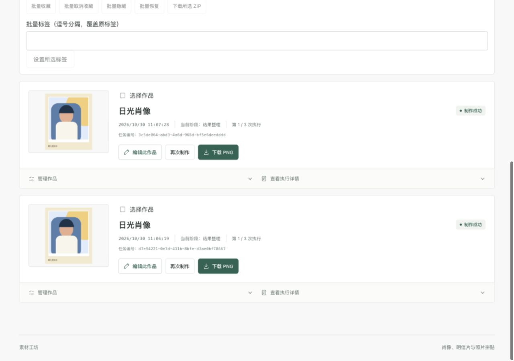
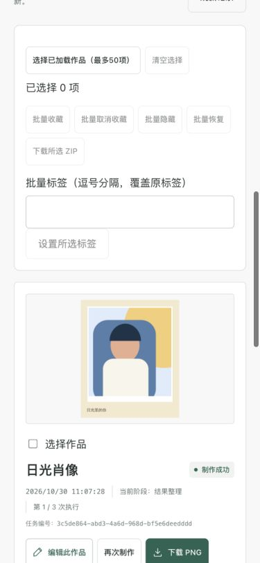

# 014 · 第10项执行架构最终验收

2026-10-30，本地完整检查通过；交付提交 `eeab22452c100dd64485319ccf694aaaa47289af` 的[远端CI](https://github.com/HangChi/material-studio/actions/runs/40997557752)前端、后端均success，014共7/7任务完成。第10项拆成独立规格：[012断点](012-validation.md)、[013租约](013-validation.md)、[014状态流](../specs/014-status-stream/spec.md)，串行实现。收尾文档提交的CI另外确认。

## 自动检查与TDD

- 后端完整 `docker compose --profile test run --rm backend-test`：95项，失败/错误/跳过均0，mvn verify打包成功，日志 `/tmp/material-014-backend-final.log`。
- 前端容器lint/typecheck、24文件120项测试、生产build通过，日志 `/tmp/material-014-front-all.log`。
- 后端4项流测试初始真实RED：路由缺失，Accept SSE下旧错误响应协商失败；实现初始/变化/终态帧、私有归属、会话重验和连接回收后GREEN。
- 前端8项真实RED：聚合源、源/版本隔离、断线和静默降级缺失，以及代理未透传禁止缓冲头；实现后定向35项及完整120项通过。
- 额外结果耐久性RED：FINALIZE已提交但确认异常，成功PNG被误删，读取返回404。实现登记路径保护和数据库不确定时保留文件后GREEN，计入95项。不把环境或fixture错误算业务RED。

## 真实代理与浏览器

独立 `material-studio-014`、端口3114，空卷V1～V14；脚本仅允许 `VERIFY_ISOLATED=true`，没有向原3000写入测试fixture。最终代码重建后运行 `scripts/verify-014.mjs`：批次 `03eff0c2-f0a2-4d1e-832e-6794c39328a7`，首帧72ms、6次快照、终态EOF；两任务各六阶段事件。未登录401、其他身份404且JSON错误；断开流不取消任务；撤销会话收到expired后关闭，旧身份GET401。首轮同样通过，首帧26ms；这些是本机测量，不是生产SLA。

实际IAB浏览器选模板、素材库、提交及再次制作，无刷新自动显示成功；新任务 `3c5de864-abd3-4a6d-968d-bf5e6deedddd` 的六事件可读。桌面1280和移动375的页面宽度均等于视口，无横向溢出。文件选择器工具超时后，使用独立卷中自制图片的素材库fixture完成浏览器流程；真实上传由代理脚本覆盖。未声称浏览器网络帧抓包或跨浏览器验收。

## 保留数据升级与边界

原3000升级前，以私有权限备份数据库及文件到忽略目录 `data/backups/before-014-20261030-3d0cbcb/`，未提交备份。保留原卷构建更新，V13/V14迁移后健康；最终结果保护修复也已重建后台。原服务未运行强杀、故障注入、写fixture或GC。独立012/013/014项目验收后down，保留卷。

默认一个后台；多后台必须共享MySQL与同一文件卷。012校验输入/PNG摘要后复用阶段；013以数据库时间租约和代次拒绝过期执行者写入，不承诺物理计算恰好一次。文件与数据库不是一个原子事务，不确定文件保留供显式审计。

014每秒读库生成完整快照，每进程最多64连接、每身份2连接、每流最多50任务，心跳10秒、寿命55秒。客户端断线/无效帧/20秒静默后立即GET补查并回退逐任务轮询；查询失败仍按任务独立暂停。没有MQ/Redis、历史事件重放、生产负载容量或TLS公网验收。
