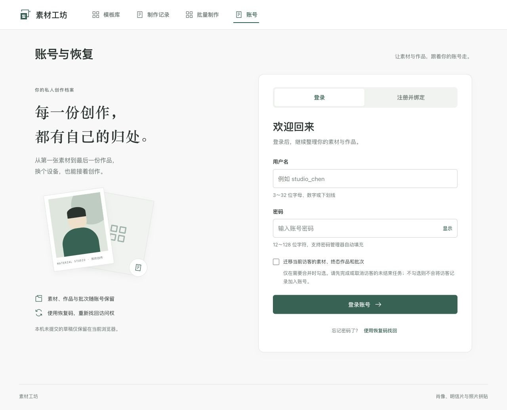
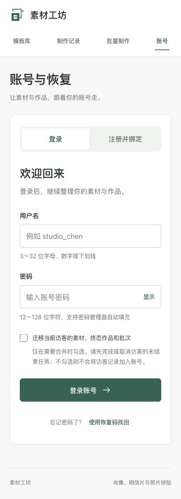

# 015 · 账号界面验收

2026-10-30，用户要求改善账号模块UI并在完成后关闭项目进程。账号API和后端未修改，无新增依赖或迁移。

## 实现与检查

桌面采用照片档案与集中表单双栏；登录/注册分段，找回为次级入口。登录态提供账号摘要、制作记录链接、安全操作列表及独立退出区；恢复码结果保持一次显示和保存确认。小屏隐藏介绍装饰，直接进入表单。

密码显示按钮不提交请求；切换模式和返回账号概览会清除并隐藏敏感输入。保留用户名/密码校验、密码管理器自动填充、访客显式迁移确认、请求防重复和卸载取消。

新增2项交互测试先真实RED，原2项恢复码/迁移测试保持通过。首次GREEN发现安全按钮名称混入副说明，补标题/说明关联后修复。前端完整容器lint/typecheck、24文件122项测试和生产构建通过，日志 `/tmp/material-015-front-all.log`。最终CSS精修生产重建通过，日志 `/tmp/material-015-ui-final.log`。后端沿用014本地95项通过基线，远端CI继续执行全部Java检查。

## 浏览器验收

实际IAB打开原3000的/account，检查登录、注册、找回切换及显示密码开关；没有提交真实凭据、注册或重置用户账号。登录态安全返回及恢复码门禁由组件测试覆盖，不冒充实际账号恢复操作。桌面宽1280、页面宽1280；移动宽375、页面宽375，均无横向溢出。发现并修正密码框双边框和小屏冗余介绍；最终密码输入内部边框为0，由外层统一描边。临时视口已恢复，验收标签页已关闭。

截图仅包含空表单、产品文案与自制CSS插画，无用户名、密码、Cookie或恢复码。

## 交付与关停

交付提交 `e754d5e7d646f3fde9c100d6055b2efe661fabbd` 的[远端CI](https://github.com/HangChi/material-studio/actions/runs/41009196174)前后端均success，015全6/6任务完成。关闭范围限本项目Compose容器和宿主运行进程，保留数据库与文件卷，不关闭Docker Desktop或其他项目。

执行 `docker compose --profile test down --remove-orphans` 成功：前端、后端、MySQL及测试MySQL均停止并移除，项目网络移除；`docker ps --filter name=material-studio` 无运行项。数据库、文件、Maven与Node缓存卷仍保留。3000、3111～3115、8080、3306无宿主监听，未发现本仓库宿主应用运行进程；工具本身和其他项目不属于关停对象。关停日志 `/tmp/material-015-shutdown.log`。最后仅提交完成状态与关停证据，并检查该文档提交的远端CI，不再启动本地服务。
