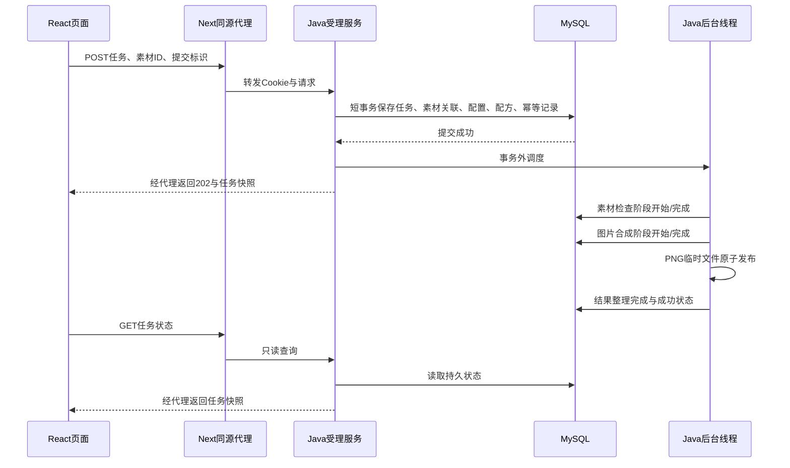

# 异步流程与扩展分析

本文依据当前源码说明实现，业务与UI已包含011。010完成可靠受理与内部监控，011完成文件生命周期、批次、作品组织和本地账号/恢复。执行证据见[011验收](011-validation.md)，限制见[验收对照](acceptance.md)。接口以[011契约](../specs/011-creative-library/contracts/http-api.md)、[010契约](../specs/010-reliable-operations/contracts/http-api.md)及其引用的前序契约为准。

## Java如何组织多步骤异步处理

一次制作包含两段：HTTP请求负责受理，独立后台线程负责执行。MySQL保存任务事实，页面是否打开不影响已受理任务。

返回202与后台执行可以交错，响应快照可能已经是处理中甚至终态；202表示已受理，不表示制作成功。

### 1. 校验与事务受理

[JobController](../backend/src/main/java/com/materialstudio/job/JobController.java)从Cookie解析当前用户，不接受客户端指定ownerId。
[JobSubmissionService](../backend/src/main/java/com/materialstudio/job/JobSubmissionService.java)校验模板、素材数量、素材归属与可用性、配方和模拟参数。

受理在同一短事务中保存`job`、`job_asset`、`job_execution`、`job_recipe`及可选的`job_request`幂等记录。相同用户通过行锁序列化受理；同一Idempotency-Key和相同规范化内容返回原任务，内容不同返回409。事务提交后才调度，worker不会读取到尚未提交的任务；图片生成不占用受理事务。

### 2. 有界线程池与持久待办

[BackgroundJobDispatcher](../backend/src/main/java/com/materialstudio/job/BackgroundJobDispatcher.java)直接使用`ThreadPoolExecutor`：一个工作线程、默认16个等待槽位、拒绝策略为`AbortPolicy`。这套实现不依赖`@Async`或消息队列。

`scheduled`集合防止同一进程重复排入同一任务。定时扫描器每250ms查询数据库中到期的QUEUED任务，补入线程池；恢复积压可以逐批执行。010起即时调度暂不可用或内存满时仍保留QUEUED，后续扫描接管。扫描每批最多读取64项，失败记录进程计数并继续下一轮。受理有独立全局/本人未完成配额和滚动一分钟速率限制：同一短事务持有全局锁检查并创建，超过限额返回429不创建；幂等回放先于配额检查。内存容量和持久受理容量分开配置。

### 3. 顺序执行和状态机

[PipelineWorker](../backend/src/main/java/com/materialstudio/job/PipelineWorker.java)按固定顺序执行：

`ASSET_CHECK 素材检查 → GENERATE 图片合成 → FINALIZE 结果整理`

每步都有独立的开始与完成边界。当前三模板使用Java2D合成，保留可配置延迟及指定阶段失败，不调用真实AI。

[PipelineState](../backend/src/main/java/com/materialstudio/job/PipelineState.java)通过短事务锁住任务行，校验前一步状态和最新事件，同时更新任务快照、递增version并追加`job_event`。正常首次成功有六条阶段边界事件；重试、恢复或取消会增加事件，管理属性修改也会增加任务版本。

耗时的sleep、图片解码、渲染和文件写入发生在阶段状态事务之外。阶段执行失败会停止后续步骤，GET接口只读状态，不负责推进流水线。

### 4. 结果发布、失败、取消与恢复

[ResultStore](../backend/src/main/java/com/materialstudio/job/ResultStore.java)先写临时PNG，再原子移动为结果文件，随后提交成功状态。文件系统和MySQL不属于同一个原子事务，强杀仍可能留下孤儿文件；系统不宣称消除了这一窗口。

- 指定阶段失败、素材失效等确定性错误直接结束；保存失败阶段与原因。
- IO及可恢复数据库错误走有限重试，默认等待1秒、2秒，从第一阶段重做；初次执行、重启恢复合计最多三次。
- 取消把任务持久化为FAILED/JOB_CANCELLED，界面显示“已取消”。当前不可分割的渲染/写盘操作可能继续到边界，但取消先提交后不能再提交成功。
- 启动时将遗留RUNNING任务恢复为QUEUED或在次数耗尽后失败，原QUEUED任务保留；终态不重新执行。

目前只支持单后端实例，不能把进程内去重和启动恢复当作跨实例领取机制。数据库完全不可写时，重试状态也可能保存失败；需要恢复数据库并重启对账。

## 前端如何管理异步状态

前端分别管理上传状态、受理请求状态、后台任务状态和查询错误，避免一个loading变量同时代表四件事。

| 层次 | 实际状态/数据 | 页面行为 |
| --- | --- | --- |
| 图片槽位 | empty/validating/uploading/ready/error | 校验、上传、预览、替换、移除及单槽重试 |
| 提交请求 | idle/submitting/error/unknown | 禁重复提交；unknown允许安全重试或核对记录 |
| 后台任务 | QUEUED/RUNNING/SUCCEEDED/FAILED及stage/version | 每个任务独立显示等待、当前阶段、结果或原因 |
| 查询请求 | errors按任务ID存储、authExpired | 查询失败保留任务快照并暂停该项；401清空私有视图 |

### 1. 素材和提交生命周期

[UploadSlots](../frontend/src/features/assets/UploadSlots.tsx)为每个槽位保存自己的状态、请求控制器和版本标识。替换/移除时abort旧上传，迟到结果通过槽位版本校验后才能更新；预览对象URL在移除或卸载时释放。

[SubmissionForm](../frontend/src/features/jobs/SubmissionForm.tsx)在素材齐全后生成提交标识，锁定本次输入并POST。收到有效202快照就加入跟踪器，表单回到可准备下一项的状态。

网络中断、5xx或无效响应不能证明服务器未受理，因此进入`unknown`，而不是让用户直接新建重复任务。原标识和完整载荷按用户/模板存入sessionStorage，安全重试复用同一操作；存储不可用时提示保留当前页面。这个重试是确认受理结果，与后台制作失败后的重新制作不同。

### 2. 按任务独立轮询

[JobTracker](../frontend/src/features/jobs/JobTracker.ts)管理任务快照、每个任务的timer、AbortController和查询错误；[useJobTracker](../frontend/src/features/jobs/useJobTracker.ts)用`useSyncExternalStore`订阅快照供React渲染。

每项未完成任务在前一次请求完成后再等1秒查询，不使用会重叠请求的固定interval。一个任务503只暂停该任务查询，不影响其他任务，也不把业务状态改为FAILED。点击“恢复查询”重新GET；终态清除该任务的请求与计时器，无活动任务时不再自动请求。

### 3. 防止旧响应污染

- 按任务ID合并快照，单任务查询响应必须匹配请求ID。
- 新生命周期递增epoch；旧请求即便未及时取消也不能更新当前视图。
- 普通快照只接受更高version，拒绝旧版本/同版本覆盖，终态不能被回退；同版本等待任务只单独更新动态排队约数。
- 页面离开或身份切换时清除timer、abort请求并清空私有快照；401也停止跟踪。

### 4. 刷新恢复与身份隔离

[History](../frontend/src/features/jobs/History.tsx)从Java读取历史分页，同时读取`/jobs/active`，确保不在第一页的旧活动任务仍被跟踪。按ID去重，分页失败保留已加载记录和游标；时间排序保留服务端的小数秒精度。

[SessionGate](../frontend/src/features/identity/SessionGate.tsx)先读取当前会话（无会话再建立匿名身份），再挂载该身份的私有组件；010起切换先原生确认，取消不动身份/视图；确认后卸载旧视图，再撤销Cookie并创建新身份。同主机Cookie跨端口共享，同源标签页共享storage通知，通过localStorage变更标记通知其他页重建视图，标记不存token；禁用存储时其他页需手动刷新。

数据库是任务事实来源；localStorage保存编辑草稿，sessionStorage保存未确认提交，两者都不代替后台任务记录。

## 可以扩展哪些内容

执行顺序1～9现已实现，下面统一编号，避免把原分析中合并的建议误认为待办。

| 顺序 | 内容 | 实现状态 |
| --- | --- | --- |
| 1 | 独立启动、远端CI、真实双标签/高对比验证 | 010验收 |
| 2 | 访客切换确认 | 010 |
| 3 | 动态模板筛选 | 010 |
| 4 | 持久排队、事务配额与限流 | 010 |
| 5 | 排队/阶段耗时、失败及扫描基础监控 | 010 |
| 6 | 孤儿盘点、快照确认隔离、保留期清理审计 | 011 |
| 7 | 原子受理批次、独立进度与取消 | 011 |
| 8 | 标签、批量作品管理、ZIP | 011 |
| 9 | 本地账号、多设备会话、恢复码和访客迁移 | 011 |

未来可选方向：合成成本显著增加时增加阶段产物与输入摘要，验证断点缺失回退和幂等发布；多worker/多实例前增加原子领取、租约、执行代次及旧worker拒绝发布；轮询量成为瓶颈时再评估SSE、断线补查、鉴权、终态关闭和轮询回退。这些尚未实施，需要独立规格。当前三个固定阶段由显式worker循环和状态机组织，消息队列、Redis、真实AI及复杂身份服务不在默认范围。

010已补远端CI首次运行、独立空卷启动、真实双标签身份切换及Chrome高对比模式实测；最新提交结果见011验收。公网部署和TLS尚未验证，本地账号并不等于生产身份服务。

## 010内部监控口径

`GET /actuator/studio`只在Java容器网络读取，Next代理不允许该路径。状态数量、首次排队时长、已完成阶段耗时与额外执行次数来自MySQL，返回样本/总毫秒/平均毫秒；阶段按相邻执行事件配对，允许管理修改造成版本跳号。失败率排除用户取消，空样本为0。扫描失败次数和最近成功时间由独立QueueScanMonitor记录，本进程重启清零；读库失败不伪装为零值。当前全量聚合适合演示规模，无时序存储或对外监控面板。

## 011对异步与身份生命周期的扩展

Java的`BatchService`在一个READ_COMMITTED外层事务保存批次及全部子任务，复用单任务校验/配额。任何子项非法则全批回滚；`JobSubmissionService`检测已有外层事务，注册`afterCommit`，数据库提交后才投递每个子任务。普通单项仍在事务结束后调度；投递失败由持久扫描接管。批次只是任务集合和进度汇总，每项继续使用原有阶段、version、事件、取消和重试，不占HTTP线程等待完成。

前端`Batches`把提交请求状态和子任务状态分开：未确认提交的key/body按owner存sessionStorage，重试复用同一载荷；已受理批次从服务端分页恢复，子项仍由`JobTracker`独立轮询、失败暂停和终态停止。标签管理和ZIP各有独立请求状态、错误提示及卸载取消，不改写任务执行状态。

`AccountService`绑定保持owner不变，多设备会话指向同一owner；显式迁移仅允许匿名源，锁定源/目标用户及受理锁，在一个事务转移素材、任务、批次和提交回执，活动任务或key冲突即回滚。恢复轮换密码/码并撤销所有旧会话，前端身份通知让其他标签清除私有状态；Cookie仍是HttpOnly，恢复码仅保留在当前组件内存。本机草稿按owner存储，不自动迁移或跨设备同步。

文件维护独立于制作线程：只读报告→快照确认隔离→7天后快照确认清理。所有登记素材/结果均保护，避免本机草稿引用失效。隔离文件移动失败补偿；清理先提交DELETING再删文件，最后记PURGED，允许中断后重试。文件系统和MySQL不共享事务，原子发布后数据库失败仍可能留下孤儿，由盘点处理。

## 第10项增量交付状态

012已完成阶段断点：原图内容/模板/配方输入摘要、合成PNG摘要、阶段完成与断点同事务登记；重试/重启优先恢复最新有效断点，失效回退，RESUMED事件不伪造重新计算。终态清理和旧产物替换清理、24h旧断点孤儿盘点保护均已覆盖，真实SIGKILL后同编号第2次成功而合成仅启动一次，见[012验收](012-validation.md)。013租约与014 SSE仍须独立验收，不能据此部署多后端。本文前面的单实例/全任务重启描述是011交付基线；当前恢复行为以012为准，最终架构说明随后续增量统一。
