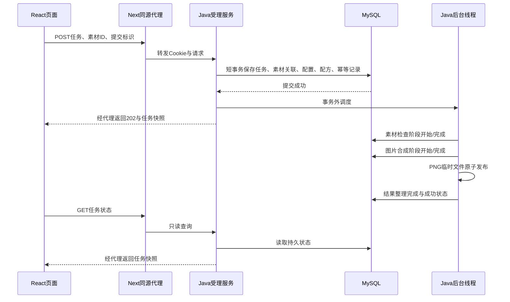

# 异步流程与扩展分析

本文依据当前源码说明实现，业务与UI基线为`af006c8`。扩展建议仅供选型，未加入已完成范围；本轮只维护文档。当前验证与限制见[验收对照](acceptance.md)，接口以[008契约](../specs/008-creative-workflow/contracts/http-api.md)及其引用的前序契约为准。

## Java如何组织多步骤异步处理

一次制作包含两段：HTTP请求负责受理，独立后台线程负责执行。MySQL保存任务事实，页面是否打开不影响已受理任务。

返回202与后台执行可以交错，响应快照可能已经是处理中甚至终态；202表示已受理，不表示制作成功。

### 1. 校验与事务受理

[JobController](../backend/src/main/java/com/materialstudio/job/JobController.java)从Cookie解析当前用户，不接受客户端指定ownerId。
[JobSubmissionService](../backend/src/main/java/com/materialstudio/job/JobSubmissionService.java)校验模板、素材数量、素材归属与可用性、配方和模拟参数。

受理在同一短事务中保存`job`、`job_asset`、`job_execution`、`job_recipe`及可选的`job_request`幂等记录。相同用户通过行锁序列化受理；同一Idempotency-Key和相同规范化内容返回原任务，内容不同返回409。事务提交后才调度，worker不会读取到尚未提交的任务；图片生成不占用受理事务。

### 2. 有界线程池与持久待办

[BackgroundJobDispatcher](../backend/src/main/java/com/materialstudio/job/BackgroundJobDispatcher.java)直接使用`ThreadPoolExecutor`：一个工作线程、默认16个等待槽位、拒绝策略为`AbortPolicy`。这套实现不依赖`@Async`或消息队列。

`scheduled`集合防止同一进程重复排入同一任务。定时扫描器每250ms查询数据库中到期的QUEUED任务，补入线程池；恢复积压可以逐批执行。当前提交即时调度遭拒时，会把仍为QUEUED的任务记为FAILED/QUEUE_REJECTED；这与扫描器遇到队列满后留待下一轮的行为不同。

### 3. 顺序执行和状态机

[PipelineWorker](../backend/src/main/java/com/materialstudio/job/PipelineWorker.java)按固定顺序执行：

`ASSET_CHECK 素材检查 → GENERATE 图片合成 → FINALIZE 结果整理`

每步都有独立的开始与完成边界。当前三模板使用Java2D合成，保留可配置延迟及指定阶段失败，不调用真实AI。

[PipelineState](../backend/src/main/java/com/materialstudio/job/PipelineState.java)通过短事务锁住任务行，校验前一步状态和最新事件，同时更新任务快照、递增version并追加`job_event`。正常首次成功有六条阶段边界事件；重试、恢复或取消会增加事件，管理属性修改也会增加任务版本。

耗时的sleep、图片解码、渲染和文件写入发生在阶段状态事务之外。阶段执行失败会停止后续步骤，GET接口只读状态，不负责推进流水线。

### 4. 结果发布、失败、取消与恢复

[ResultStore](../backend/src/main/java/com/materialstudio/job/ResultStore.java)先写临时PNG，再原子移动为结果文件，随后提交成功状态。文件系统和MySQL不属于同一个原子事务，强杀仍可能留下孤儿文件；系统不宣称消除了这一窗口。

- 指定阶段失败、素材失效等确定性错误直接结束；保存失败阶段与原因。
- IO及可恢复数据库错误走有限重试，默认等待1秒、2秒，从第一阶段重做；初次执行、重启恢复合计最多三次。
- 取消把任务持久化为FAILED/JOB_CANCELLED，界面显示“已取消”。当前不可分割的渲染/写盘操作可能继续到边界，但取消先提交后不能再提交成功。
- 启动时将遗留RUNNING任务恢复为QUEUED或在次数耗尽后失败，原QUEUED任务保留；终态不重新执行。

目前只支持单后端实例，不能把进程内去重和启动恢复当作跨实例领取机制。数据库完全不可写时，重试状态也可能保存失败；需要恢复数据库并重启对账。

## 前端如何管理异步状态

前端分别管理上传状态、受理请求状态、后台任务状态和查询错误，避免一个loading变量同时代表四件事。

| 层次 | 实际状态/数据 | 页面行为 |
| --- | --- | --- |
| 图片槽位 | empty/validating/uploading/ready/error | 校验、上传、预览、替换、移除及单槽重试 |
| 提交请求 | idle/submitting/error/unknown | 禁重复提交；unknown允许安全重试或核对记录 |
| 后台任务 | QUEUED/RUNNING/SUCCEEDED/FAILED及stage/version | 每个任务独立显示等待、当前阶段、结果或原因 |
| 查询请求 | errors按任务ID存储、authExpired | 查询失败保留任务快照并暂停该项；401清空私有视图 |

### 1. 素材和提交生命周期

[UploadSlots](../frontend/src/features/assets/UploadSlots.tsx)为每个槽位保存自己的状态、请求控制器和版本标识。替换/移除时abort旧上传，迟到结果通过槽位版本校验后才能更新；预览对象URL在移除或卸载时释放。

[SubmissionForm](../frontend/src/features/jobs/SubmissionForm.tsx)在素材齐全后生成提交标识，锁定本次输入并POST。收到有效202快照就加入跟踪器，表单回到可准备下一项的状态。

网络中断、5xx或无效响应不能证明服务器未受理，因此进入`unknown`，而不是让用户直接新建重复任务。原标识和完整载荷按用户/模板存入sessionStorage，安全重试复用同一操作；存储不可用时提示保留当前页面。这个重试是确认受理结果，与后台制作失败后的重新制作不同。

### 2. 按任务独立轮询

[JobTracker](../frontend/src/features/jobs/JobTracker.ts)管理任务快照、每个任务的timer、AbortController和查询错误；[useJobTracker](../frontend/src/features/jobs/useJobTracker.ts)用`useSyncExternalStore`订阅快照供React渲染。

每项未完成任务在前一次请求完成后再等1秒查询，不使用会重叠请求的固定interval。一个任务503只暂停该任务查询，不影响其他任务，也不把业务状态改为FAILED。点击“恢复查询”重新GET；终态清除该任务的请求与计时器，无活动任务时不再自动请求。

### 3. 防止旧响应污染

- 按任务ID合并快照，单任务查询响应必须匹配请求ID。
- 新生命周期递增epoch；旧请求即便未及时取消也不能更新当前视图。
- 普通快照只接受更高version，拒绝旧版本/同版本覆盖，终态不能被回退；同版本等待任务只单独更新动态排队约数。
- 页面离开或身份切换时清除timer、abort请求并清空私有快照；401也停止跟踪。

### 4. 刷新恢复与身份隔离

[History](../frontend/src/features/jobs/History.tsx)从Java读取历史分页，同时读取`/jobs/active`，确保不在第一页的旧活动任务仍被跟踪。按ID去重，分页失败保留已加载记录和游标；时间排序保留服务端的小数秒精度。

[SessionGate](../frontend/src/features/identity/SessionGate.tsx)先建立匿名身份，再挂载该身份的私有组件；切换时先卸载旧视图，再撤销Cookie并创建新身份。同源标签页共享Cookie，通过localStorage变更标记通知其他页重建视图，标记不存token；禁用存储时其他页需手动刷新。

数据库是任务事实来源；localStorage保存编辑草稿，sessionStorage保存未确认提交，两者都不代替后台任务记录。

## 可以扩展哪些内容

以下按收益和现有架构的适配程度分析。它们尚未实现，不自动成为开发范围；添加账号体系、外部服务或多实例时应先调整规格和仓库边界。

| 顺序 | 方向与触发需求 | 建议实现与验收重点 |
| --- | --- | --- |
| 1 | 身份误切换防护 | 切换前明确确认原身份不可找回；测试取消不撤销、确认只执行一次，并做真实双标签验证 |
| 2 | 队列满时继续排队 | 复用现有持久扫描器，将容量拒绝转为保留QUEUED；增加总待办配额和限流，测试满队列最终执行及提交不阻塞 |
| 3 | 日常排障与资源管理 | 增加排队时长、阶段耗时、失败率、重试次数和扫描失败指标；先做孤儿文件只读盘点，再设计保留期与可审计清理，避免删掉草稿/任务仍引用素材 |
| 4 | 模板配置一致性 | 历史筛选复用模板接口，集中模板渲染注册与参数校验；测试新增模板后列表、制作与筛选一致 |
| 5 | 批量制作与作品组织 | 增加明确的批次实体、进度汇总、标签和批量下载；每个子任务仍独立，测试部分失败、取消和刷新恢复 |
| 6 | 账号或身份恢复 | 有跨设备使用需求时，设计访客数据迁移、身份绑定和恢复；不能只添加登录页，必须验证所有权迁移及冲突处理 |
| 7 | 阶段断点续跑 | 仅在合成成本明显增加时保存中间产物、阶段输入摘要和完成标记；测试重启不重做已完成阶段、产物缺失回退及幂等发布 |
| 8 | 多worker/多实例 | 任务变多后增加数据库原子领取、租约与执行代次，旧worker发布时校验代次；测试并发领取唯一性、租约到期接管和旧结果不能覆盖 |
| 9 | SSE状态推送 | 活动任务较多、轮询请求量成为问题时，再加推送；仍由MySQL状态与version去重，支持断线补查、鉴权、终态关闭和轮询回退 |

优先建议先完成1～4和交付验证，再按实际需求选择批量制作或账号恢复。当前阶段顺序固定，显式worker循环和状态机足够；没有必要为三个步骤先引入通用工作流引擎。消息队列、Redis、真实AI及复杂身份服务不在当前仓库默认范围，本文不提出直接接入。

交付验证另列：远端CI首次运行、独立空卷冷启动、真实双标签身份切换及高对比模式实测。公网部署和TLS不属于原题强制项，需要部署需求时再验证。
