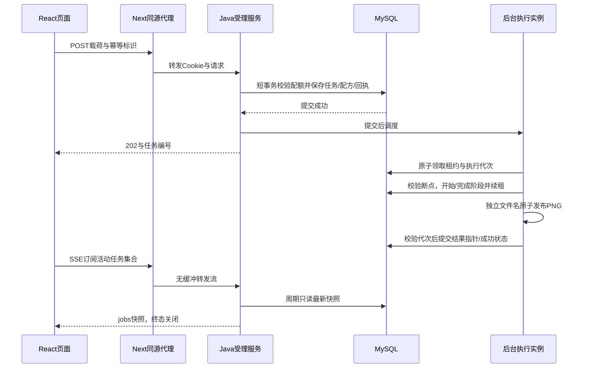

# 异步流程与执行架构

本文对应014源码。第10项已拆为[012断点](012-validation.md)、[013租约](013-validation.md)、[014推送](014-validation.md)三个独立增量；具体检查与远端状态以各验收记录为准。接口以[014契约](../specs/014-status-stream/contracts/http-api.md)、[011契约](../specs/011-creative-library/contracts/http-api.md)、[010契约](../specs/010-reliable-operations/contracts/http-api.md)及其引用的前序契约为准。

## Java如何组织多步骤异步处理

请求只负责受理，后台线程负责制作，MySQL保存任务事实。关闭页面不取消已受理任务。

返回202和后台执行可以交错；202只表示受理。无需让HTTP线程等待三个阶段。

### 1. 校验与事务受理

[JobSubmissionService](../backend/src/main/java/com/materialstudio/job/JobSubmissionService.java)校验模板、素材归属/可用性、配方与模拟参数，按本人序列化幂等回执，持有受理锁检查全局/本人待办配额和一分钟速率。超额429且不创建；同key同内容回放优先于配额检查。

单项在事务结束后调度；[BatchService](../backend/src/main/java/com/materialstudio/batch/BatchService.java)的1～10项在一个外层事务受理，子项注册afterCommit，任一失败全批回滚、零调度。已受理任务不因内存队列满转成失败。

### 2. 每实例有界队列与持久扫描

[BackgroundJobDispatcher](../backend/src/main/java/com/materialstudio/job/BackgroundJobDispatcher.java)每进程单工作线程、默认16等待槽位，进程内scheduled集合去重；每250ms从DB扫描最多64项到期待办或租约过期的运行项。队列满/即时投递失败仍保留持久待办，后续扫描接管。扫描故障记录计数并继续下一轮。

默认仍一个后台。扩为多个实例时必须共享MySQL和素材卷；本机集合只去重本进程，跨实例安全由租约负责。

### 3. 租约、执行代次与阶段状态机

[LeaseGuard](../backend/src/main/java/com/materialstudio/job/LeaseGuard.java)在短事务先锁job再操作runtime；领取获得递增generation和进程owner，默认15秒租约、每lease/3续期，最小3秒。领取可用时刻、退避和租约判断均用数据库时间；过期租约不可复活。

[PipelineState](../backend/src/main/java/com/materialstudio/job/PipelineState.java)在每次开始、完成、失败或重排时锁任务，验证当前线程的owner/generation/有效期，再更新快照、递增version并追加事件。阶段固定为ASSET_CHECK素材检查→GENERATE图片合成→FINALIZE结果整理。首次正常成功六条边界事件；恢复、取消和管理可能增加版本。

启动和扫描只恢复过期租约或旧版无租约RUNNING，不重置其他实例的有效执行。旧代次失效后可能继续计算，但不能提交状态或断点；release也不能清除后继代次。用户取消独立将任务设为FAILED/JOB_CANCELLED，终态不回退。

### 4. 阶段断点与有限重试

[CheckpointStore](../backend/src/main/java/com/materialstudio/job/CheckpointStore.java)保存素材检查和合成完成标记；输入摘要含渲染版本、模板、配方、有序素材及原图内容SHA256，合成PNG另有内容摘要。完成事件与断点同DB事务提交，只有已登记且校验一致的产物可复用；渲染语义升级时须更新摘要版本。

缺失/损坏/输入改变时回退最近有效阶段，旧任务无断点可从头执行。有效合成断点让重试直接整理结果；RESUMED事件说明恢复位置，恢复仍计一次执行。暂时IO/可恢复数据库错误默认退避1秒、2秒，初次与恢复合计最多三次；指定模拟失败、失效素材或取消不自动重试。未取得执行代次期间无法持久记账的数据库故障不会伪造已执行次数。

### 5. 文件发布与提交边界

[ResultStore](../backend/src/main/java/com/materialstudio/job/ResultStore.java)先临时PNG，再原子移动为每次独立的UUID文件，最后由代次校验后的DB事务登记结果指针。公开结果URL仍按任务ID读取；旧线程不能覆盖胜者文件。文件系统和MySQL不共享事务，未登记孤儿窗口仍存在。

终态清理断点，替换旧产物在提交后清理；批次取消必须等最外层提交，清理登记用独立事务。内部文件维护保护所有登记素材/结果/断点，24小时旧孤儿需快照确认隔离，保留7天后再次确认清理，默认无自动删除。

## 前端如何管理异步状态

前端分别管理上传、提交、后台快照、传输和逐项查询错误，不能把网络失败写成制作FAILED。

| 状态 | 作用与恢复方式 |
| --- | --- |
| 上传 | 每槽位选择/上传/就绪/失败；旧请求不覆盖新图片，未全部就绪不能提交 |
| 提交 | submitting/unknown分离；丢响应复用同key/body安全重试，不另发制作 |
| 后台快照 | 按ID的status/stage/version与结果/执行原因，服务端为准 |
| SSE传输 | 一个源、订阅集合、20秒watchdog及回退标记；断线补查，不改业务状态 |
| 查询错误 | 只暂停对应任务，保留快照，用户可恢复；其他任务继续 |

### 1. 提交不确定性与身份

未确认提交的key/完整载荷按owner/模板保存在sessionStorage；存储不可用时当前页仍可重试，刷新不能恢复，页面明确提示。本机编辑草稿在localStorage，不代替后台记录，也不自动跨设备同步。

[SessionGate](../frontend/src/features/identity/SessionGate.tsx)通过兼容POST读取或初始化会话；018移除游客重置入口，保留稳定游客及账号管理/退出。退出中立即卸载私有视图，成功撤销会话后建立游客，不删除作品。账号绑定保持owner；显式访客迁移拒绝活动源/标识冲突。跨标签通知只存变更标记，不存token；存储禁用时其他页需刷新。

### 2. 一个源观察多个任务

[JobTracker](../frontend/src/features/jobs/JobTracker.ts)由useSyncExternalStore订阅。有EventSource能力时，把最多50项无查询错误的活动任务合并为一个源；活动集合变化重建。每帧必须完整匹配订阅ID集合且满足Job校验，复用version/终态保护；旧source和旧epoch回调全部忽略。

[JobStreamService](../backend/src/main/java/com/materialstudio/job/JobStreamService.java)初次发最新jobs快照，之后每秒读DB、变化才发送；10秒心跳，每进程最多64连接、每owner2、默认55秒寿命。周期重验会话，撤销发送expired并结束；全部终态关闭。Next直接转发body和Abort，透传防缓冲头，不把流读成完整JSON再返回。

### 3. 回退仍是独立轮询

断线、unavailable、无效帧或20秒静默时关闭源，立即逐项GET补查，然后沿用原1秒轮询：前一请求完成后再计时，不重叠；某项503只暂停该项。当前生命周期保持轮询，手动恢复查询或重开页面可再尝试SSE。没有EventSource能力时直接使用原轮询。

SSE的expired或补查401会清空私有状态并停止。终态/离开/换身份清理源、watchdog、timer和AbortController；不重发POST。重连读取最新快照，不承诺每个中间状态都推到；完整阶段历史仍在/events。

### 4. 刷新与版本隔离

[History](../frontend/src/features/jobs/History.tsx)读取历史分页及active集合，恢复不在首屏的旧活动任务；按ID去重，分页失败保留记录/游标，排序保留微秒精度。只接受更高版本的常规快照，终态不回退；相同版本待办可单独更新动态排队约数。

## 执行顺序与实际边界

1～5由010完成交付验证、身份确认、动态模板、持久排队/配额和内部监控；6～9由011完成文件维护、批次、组织和账号恢复。第10项分别由012、013、014交付断点、租约和SSE，证据见各自验收，规划不代替结果。

内部/actuator/studio统计状态、首次排队/阶段耗时、失败与额外执行次数；空样本为0，阶段按相邻执行事件配对允许管理版本跳号。扫描计数为进程内监控，重启清零。Next不代理管理入口。

SSE减少客户端HTTP轮询，服务器仍周期读MySQL，不是消息广播总线。租约保证当前代次提交权，不保证计算恰好一次；共享卷、生产负载均衡/跨地域复制和吞吐SLA均不自动提供。无真实AI、MQ或Redis，阶段内部不做百分比断点。具体测试数量、原服务升级、截图与CI见[验收对照](acceptance.md)及[014验收](014-validation.md)。

最终发布的事务确认丢失时，worker先检查已登记的结果路径：保留已提交成功文件；数据库不可读时也保留待审计，避免误删。文件与数据库仍不构成一个原子事务。
